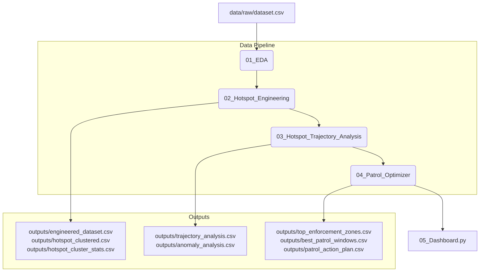

# Parking Violation Analysis & Patrol Optimization System
## Project Documentation

This documentation provides a detailed, simple, and structured overview of the 4 notebooks and the interactive dashboard that make up the Parking Violation Analysis and Patrol Optimization system.

---

## System Overview & Architecture

The system is designed to take raw parking violation data and transform it into actionable intelligence for traffic enforcement. The workflow progresses through four main phases:

---

## 1. Notebook 1: Exploratory Data Analysis (EDA)
**File:** [01_EDA.ipynb](notebooks/01_EDA.ipynb) (Converted version: [01_EDA.py](src/01_EDA.py))

### What We Are Trying to Do
Understand the characteristics of the raw violation data, identify data quality issues (missing values, duplicate rows, incorrect GPS coordinates), and validate whether a parking-only subset is actually needed before downstream modeling.

### How We Did It
1. **Initial Assessment:** Loaded the raw dataset (`data/raw/dataset.csv`) and checked the count of rows and columns.
2. **Missing & Duplicate Values:** Calculated null percentages for critical fields (timestamps, junction names, vehicle types, validation status) and checked for duplicate rows.
3. **GPS Validation:** Checked the boundaries of latitude and longitude columns to ensure coordinate validity.
4. **Timestamp Parsing:** Converted raw UTC timestamps (`+00:00`) to `Asia/Kolkata` before extracting temporal attributes (`hour`, `day_of_week`, `month`, `week`, `is_weekend`) so all temporal analysis reflects Bengaluru local event time.
5. **Categorical Distributions:** Analyzed which vehicle types, police stations, and junctions show the highest frequencies of violations.
6. **Parking Coverage Validation:** Checked whether records contain parking-related offences before creating a separate subset. In this dataset, all **298,450** records already contain at least one parking-related offence, so filtering does not reduce the dataset.
7. **Spatial Density Check:** Grouped coordinates rounded to 3 decimal places to perform a preliminary count of hotspot candidates.

### Timestamp Validation Notes
* **Primary Event Clock:** `created_datetime` is treated as the violation creation timestamp and is the source for local temporal features.
* **Coverage Checks:** Before conversion, the pipeline prints total rows, valid timestamps, and null percentage for each datetime column.
* **Skipped Columns:** `closed_datetime` and `action_taken_timestamp` are currently 100% null in the raw dataset, so response-time and closure-time features are intentionally not engineered.
* **Warnings:** Timestamp columns with less than 10% usable observations are still parsed, but the pipeline prints a warning that time-based analysis may be unstable.

### EDA Findings You Can Report Confidently
* Violations peak during the morning hours, especially from **8 AM to 12 PM**.
* The highest hourly counts occur around **10 AM (32,580)** and **11 AM (32,176)**.
* Violations decline after noon and become much less frequent after **6 PM**.
* **Sunday (50,160)** records the highest number of violations, followed by Saturday, while Monday has the fewest.
* Converting timestamps from UTC to `Asia/Kolkata` was necessary; otherwise all temporal patterns would have been shifted by **5.5 hours**.
* The dataset spans approximately **November to April**, and monthly comparisons should be interpreted cautiously because November and April appear to be only partially covered.
* All **298,450** records already include at least one parking-related offence, so repeating temporal analysis on a filtered `parking_df` is redundant.

### Interpretation Guidance
* Morning and weekend concentration can be described as plausible demand-related patterns, but those explanations are hypotheses rather than conclusions proven by the dataset alone.
* Apparent month-to-month change should not be overinterpreted because the time window is short and coverage is incomplete.
* The data does not support a strong claim that enforcement actions reduced violations over time; alternative explanations include partial months, deployment changes, and policy changes.

### Workflow Findings
* Approximately **42%** of records do not have a validation status.
* Among non-missing statuses, `approved` is the most common outcome, followed by `rejected`.
* Other statuses such as `created1`, `processing`, and `duplicate` account for only a small share of records.

### Spatial Findings
* Approximately half of all parking violations occur near identified junctions, while the rest are represented only by coordinates.
* Violations are concentrated within a relatively small number of police station jurisdictions.
* Grid-based aggregation reveals several dense hotspot cells, supporting later clustering and hotspot prioritization.
* Latitude and longitude should be preferred over junction names for precise hotspot identification because many records do not map cleanly to a named junction.

### Multi-Violation Findings
* About **86.6%** of records contain only a single offence.
* Roughly **11%** contain two simultaneous violations.
* Three or more violations are uncommon, accounting for only about **2%** of records.
* A very small number of records contain exceptionally high counts of violations, making them reasonable outlier candidates.

---

## 2. Notebook 2: Hotspot Engineering & Clustering
**File:** [02_Hotspot_Engineering.ipynb](notebooks/02_Hotspot_Engineering.ipynb) (Converted version: [02_Hotspot_Engineering.py](src/02_Hotspot_Engineering.py))

### What We Are Trying to Do
Clean the dataset, design domain-specific risk weighting factors (based on violation severity, vehicle size, and junction impact), cluster coordinates to generate geographic **hotspots**, and rank these hotspots by risk.

### How We Did It
1. **Cleaning:** Retained records with validation_status equal to approved or missing (NaN). Records with statuses such as rejected, duplicate, created1, and processing are excluded from downstream hotspot analysis.
2. **Severity Weighting:** Mapped violation types to a severity score from `1` (least disruptive, e.g., NO PARKING) to `7` (most disruptive, e.g., PARKING NEAR TRAFFIC LIGHT OR ZEBRA CROSSING).
3. **Vehicle Weighting:** Mapped vehicle categories to weight scores from `1.0` (scooters/mopeds) to `4.0` (Heavy Goods Vehicles) since larger vehicles obstruct traffic more.
4. **Junction Weighting:** Scored junctions dynamically based on historical frequencies (normalized between `0` and `1`).
5. **Spatial Clustering (DBSCAN):** Grouped GPS coordinates using DBSCAN with `eps=0.00000962` radians (approximately 61 meters) and `min_samples=20`, using the Haversine metric and BallTree algorithm.
6. **Priority Scoring:** Computed a composite priority score (`0` to `1`) for each cluster using weighted variables:
   * **Log Violations (45%)**
   * **Average Severity (20%)**
   * **Active Months/Persistence (10%)**
   * **Average Vehicle Weight (10%)**
   * **Average Junction Weight (10%)**
   * **Average Number of Violations Per Event (5%)**
7. **Risk Classification:** Grouped clusters into risk levels based on priority score percentiles:
   * **Low:** 0–50%
   * **Medium:** 50–80%
   * **High:** 80–95%
   * **Critical:** 95–100%

### Key Outputs
* `outputs/engineered_dataset.csv`: Intermediate dataset containing computed weights.
* `outputs/hotspot_clustered.csv`: Main dataset containing the original data labeled with DBSCAN `cluster_id` numbers.
* `outputs/hotspot_cluster_stats.csv`: Aggregated cluster metrics containing coordinates, priority scores, risk levels, and associated police stations.

---

## 3. Notebook 3: Trajectory & Anomaly Analysis
**File:** [03_Hotspot_Trajectory_Analysis.ipynb](notebooks/03_Hotspot_Trajectory_Analysis.ipynb) (Converted version: [03_Hotspot_Trajectory_Analysis.py](src/03_Hotspot_Trajectory_Analysis.py))

### What We Are Trying to Do
Understand if violation rates in individual hotspots are getting better or worse over time (trajectory) and identify hotspots experiencing abnormal surges in violation counts during the current month (anomaly detection).

### How We Did It
1. **Monthly Aggregation:** Grouped the locally converted `created_datetime` values by year-month and constructed a pivot table of monthly violation counts.
2. **Trajectory Slopes (Linear Regression):** Fitted a linear regression line over time for each cluster to calculate its slope (trend).
3. **Trajectory Classification:** Evaluated the slope distributions:
   * **Declining:** Slope is at or below the 25th percentile (traffic getting better).
   * **Escalating:** Slope is at or above the 75th percentile (traffic getting worse).
   * **Stable:** Slopes between the 25th and 75th percentiles.
   * **Insufficient History:** Less than 2 active months.
4. **Anomaly Scoring (Z-Score):** Calculated the mean and standard deviation of monthly violations for each hotspot. Compared the latest month (March 2024) to this history:
   $$\text{Z-Score} = \frac{\text{Current Month Count} - \text{Historical Mean}}{\text{Historical Std}}$$
5. **Surge Labeling:** If the latest month's count is $>1.5$ standard deviations above the mean (Z-Score $> 1.5$), it is flagged as an **Abnormal Surge**.

### Key Outputs
* `outputs/trajectory_analysis.csv`: Contains the slope, R² (trend reliability), and trajectory labels for each cluster.
* `outputs/anomaly_analysis.csv`: Contains the historical statistics, current month counts, Z-scores, and anomaly flags for each cluster.

---

## 4. Notebook 4: Patrol Routing & Optimizer
**File:** [04_Patrol_Optimizer.ipynb](notebooks/04_Patrol_Optimizer.ipynb) (Converted version: [04_Patrol_Optimizer.py](src/04_Patrol_Optimizer.py))

### What We Are Trying to Do
Combine risk levels, trends, and current anomalies to calculate an overall operational **patrol priority**. Using this priority, identify the top 20 enforcement zones and optimize their patrol schedules (day of week and hour of day).

### How We Did It
1. **Composite Priority Score:** Combined variables to rank overall urgency:
   * **Priority Norm (50%):** Geographic severity and volume.
   * **Trajectory Weight (30%):** Scales regression slope by R² confidence.
   * **Anomaly Weight (20%):** Z-score intensity of recent surges.
2. **Zone Identification:** Extracted the top 20 hotspots based on the new composite `patrol_priority`.
3. **Temporal Window Profiling:** For these top hotspots, grouped historical violations by Bengaluru local day-of-week and hour-of-day.
4. **Schedules Optimization:** Ranked time windows using a combined score: **75% violation counts** and **25% average severity**.
5. **Patrol Recommendations:** Extracted the top 3 ranked patrol windows for each zone using a heuristic score based on violation volume and average severity.
6. **Deployment Level Categorization:** Binned hotspots into operational categories:
   * **Routine Monitoring:** Score $\le 0.4$
   * **Targeted Patrol:** Score $0.4 - 0.7$
   * **Immediate Enforcement:** Score $> 0.7$

### Key Outputs
* `outputs/top_enforcement_zones.csv`: The top 20 prioritized hotspot locations.
* `outputs/best_patrol_windows_detailed.csv`: Hour-by-hour probability profiles for active zones.
* `outputs/best_patrol_windows.csv`: Summary of the top 3 recommended patrol windows per cluster.
* `outputs/patrol_action_plan.csv`: Operational roster matching stations to clusters, priority scores, deployment levels, and recommended windows.

---

## 5. Streamlit Dashboard
**File:** [05_Dashboard.py](src/05_Dashboard.py)

### What We Are Trying to Do
Present the analytical findings in an interactive, user-friendly control room application for traffic supervisors.

### Key Tabs & How They Work
* **KPI Overview:** Highlights high-level indicators like total active hotspots, count of Critical hotspots, average violation severity, and zones needing patrol.
* **Risk Zones:** Displays an interactive map (Mapbox scatter plot) of hotspot centroids. Centroids are sized by violation counts and colored by risk level, paired with a leaderboard.
* **Temporal Patterns:** Renders a time-series chart showing historical violation trends and a weekday-vs-hour heatmap showing optimal enforcement times in Bengaluru local time.
* **Patrol Plan:** Renders the operational patrol roster. Users can filter by police station to see which hotspots under their jurisdiction require "Immediate Enforcement" and the recommended patrol hours, all based on locally converted event time.
* **Watchlist & Anomalies:** Isolates the active zones experiencing "Abnormal Surges" this month, sorting them by Z-score.
* **Impact Simulator:** Allows supervisors to simulate how enforcement decreases violations.
  * *Methodology:* Users slide a percentage (0% to 50%) to model reduction in violations.
  * *Anchor Normalization:* The system scales down violations, recalculates priority scores, and classifies new risk categories. Crucially, the simulator references the **original baseline quantiles** so that reductions are absolute and do not cause "quantile dilution" (where lower numbers are pushed back up into critical levels).

---

## Data Pipelines Summary File Map

Below is a reference map of files involved and how data flows through them:

| File Name | Purpose | Format | Generated By |
| :--- | :--- | :--- | :--- |
| `data/raw/dataset.csv` | Raw traffic violation log | CSV | Inputs (Raw) |
| `src/temporal_utils.py` | Shared UTC-to-IST conversion and timestamp validation helpers | Python | Pipeline Support |
| `notebooks/01_EDA.ipynb` | Initial exploration and filtering | Notebook | Pipeline Step 1 |
| `notebooks/02_Hotspot_Engineering.ipynb` | Weights engineering and DBSCAN clustering | Notebook | Pipeline Step 2 |
| `outputs/hotspot_clustered.csv` | Original rows with DBSCAN cluster IDs | CSV | `02_Hotspot_Engineering.py` |
| `outputs/hotspot_cluster_stats.csv` | Extracted hotspot attributes & base priority scores | CSV | `02_Hotspot_Engineering.py` |
| `notebooks/03_Hotspot_Trajectory_Analysis.ipynb` | Trend fitting and current month anomaly Z-scores | Notebook | Pipeline Step 3 |
| `outputs/trajectory_analysis.csv` | Trajectory regression slopes and labels | CSV | `03_Hotspot_Trajectory_Analysis.py` |
| `outputs/anomaly_analysis.csv` | Historical means, latest counts, and surge flags | CSV | `03_Hotspot_Trajectory_Analysis.py` |
| `notebooks/04_Patrol_Optimizer.ipynb` | Combined patrol priority & scheduling engine | Notebook | Pipeline Step 4 |
| `outputs/patrol_action_plan.csv` | Actionable deploy roster with windows and levels | CSV | `04_Patrol_Optimizer.py` |
| `src/05_Dashboard.py` | Command-center dashboard interface | Streamlit app | Visualization |
